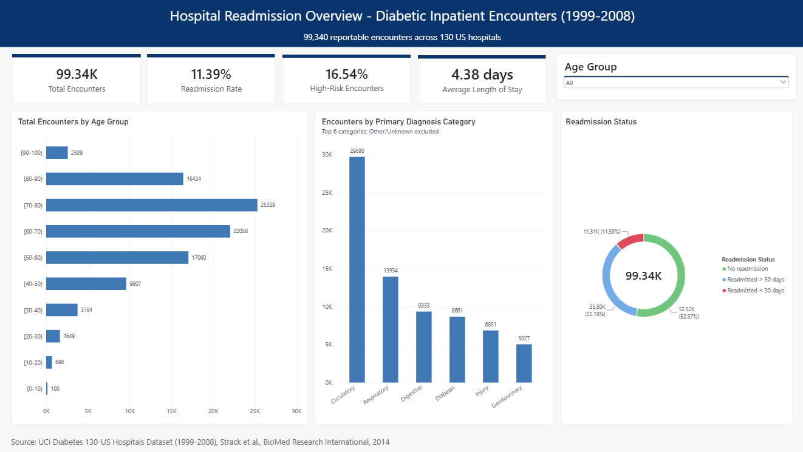
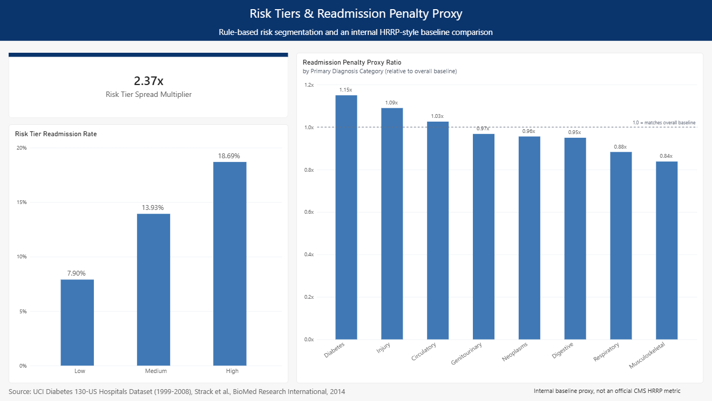
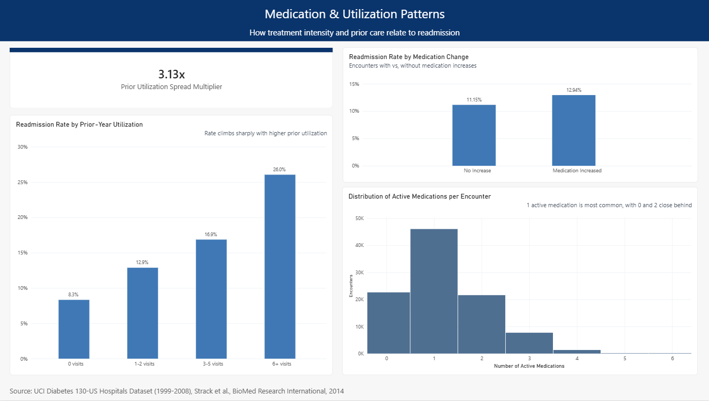

# Hospital Readmission Reporting & Utilization Analysis

A SQL and BI-first analysis of 99,340 diabetic inpatient encounters across 130 US hospitals (1999-2008): a Python ETL, a normalized MySQL schema, a layer of reporting views, and a four-page Power BI dashboard. 

## Headline results
| Finding | Result |
| --- | --- |
| Overall 30-day readmission rate | 11.39% (11,314 of 99,340 reportable encounters) |
| Rule-based risk tier (Low / Medium / High ) | 7.90% / 13.93% / 18.69%, a 2.37x spread |
| Prior-year utilization (0 visits vs. 6+ visits) | 8.3% vs. 26.0%, a 3.13x spread |
| Discharge destination (home vs. psychiatric facility) | 9.30% vs. 36.69%, nearly 4x |
| Diagnosis category (Diabetes vs. Musculoskeletal) | 13.10% vs. 9.54% (1.15x vs. 0.84x of baseline) | 
| Medication dose increased vs. not | 12.94% vs. 11.15% |

The full write-up, including findings, methodology, and limitations, is in `docs/findings_and_methodology.md`.

## Why SQL/BI-first

Most public analyses of this dataset train a machine learning classifier. This project takes the reporting route instead:

- **Auditable:** The risk tier is three `CASE` rules (prior-year visits, membership in the three highest-readmission diagnosis categories, non-home discharge). Every point of the score can be read straight off the query.
- **Operational:** Readmissions are counted per encounter, the way an operations team tracks them, rather than one encounter per patient as the source paper required for its regression model.
- **Honest about scope:** The HRRP-style penalty metric is an internal, dataset-relative proxy and is labeled that way everywhere, including on the dashboard itself.

## Dataset

**Diabetes 130-US Hospitals (1999-2008)**, from the UCI Machine Learning Repository. Original research: Strack et al., "Impact of HbA1c Measurement on Hospital Readmission Rates," *BioMed Research International*, 2014.

- 101,766 raw encounters x 50 columns, one row per inpatient encounter
- 71,518 unique patients; 16,773 with two or more encounters
- 2,423 terminal-discharge encounters (death and hospice, 2.38%) are excluded at the view layer and never deleted from the base tables

## Pipeline

diabtic_data.csv -> Python ETL -> MySQL -> Views -> SQL reporting -> Power BI

| Stage | What it does | Output |
| --- | --- | --- | --- |
| `etl/01_transform.py` | Cleans and reshapes the raw CSV | 4 clean CSVs: 71,515 patients, 101,763 encounters, 305,289 diagnoses, 120,050 medications |
| `etl/02_load_mysql.py` | Loads the CSVs into MySQL in foreign-key-safe order, in batches of 5,00 | Populated `hospital_readmission` database |
| `views/` | Reporting views, including risk tier and penalty proxy | 6 views |
| `reporting/` | Descriptive, cohort, window-function, risk, and penalty-proxy queries | 5 SQL files |
| `dashboard/` | Power BI report connected directly to the views | 4-page dashboard |

## Repository structure

```
data/
  raw/          diabetic_data.csv
  processed/    patients.csv, encounters.csv, diagnoses.csv, medications.csv
docs/
  Hospital Readmission Analysis - Findings & Methodology.pdf
  data_profiling_and_cleaning_decisions.md
  icd9_category_mapping.md
  images/      dashboard screenshots used in this README
etl/
  01_transform.py
  02_load_mysql.py
schema/
  01_schema.sql          DDL
  02_lookup_data.sql    lookup tables, from the official IDS_mapping.csv
  erd.dbml
  erd.png
views/
  01_views.sql
  02_risk_tier_view.sql
  03_penalty_proxy_view.sql
reporting/
  01_descriptive_reports.sql
  02_cohort_definitions.sql
  03_window_functions.sql
  04_risk_segmentation.sql
  05_hrrp_penalty_proxy.sql
dashboard/
  hospital_readmission_dashboard.pbix
```

## Schema

Four core tables plus five lookup tables (see `schema/erd.png`):
- `patients`: one row per patient (`race`, `gender`)
- `encounters`: one row per encounter, including `age_group`, utilization counts, labs, and the `readmitted` outcome
- `diagnoses`: long format, up to three ICD-9 diagnoses per encounter, grouped into categories following Strack et al. (2014)
- `medications`: long format, only rows where the drug status is not `No`
- Lookups: age, admission type, discharge disposition (with an `is_terminal_discharge` flag), admission source, diagnosis category

Main reporting views:

| View | Purpose |
| --- | --- |
| `vw_reportable_encounters` | All encounters minus terminal discharges (99,340 rows) |
| `vw_primary_diagnosis` | Position-1 diagnosis per encounter |
| `vw_medication_summary` | Per-encounter medication activity |
| `vw_encounter_full` | Main reporting view; feeds both the SQL reports and Power BI |
| `vw_encounter_risk_tier` | Rule-based risk score and tier |
| `vw_diagnosis_category_penalty_proxy` | Category readmission rate relative to the dataset baseline |

## Key design decisions

- **`age_group`** lives on `encounters`, not `patients`. **Profiling showed 1,574 patients with more than one age value, and 98.9% of those aged monotonically across the study period, so age is time-varying.
- **No one-encounter-per-patient restriction.** That is a modeling assumption in the source paper, not a reporting requirement.
- **Only non-`No` medication rows are stored.** A row for every drug in every encounter would be about 2.1 million mostly uninformative placeholders.
- **Dropped columns:** `weight` (96.86% missing), plus `examide` and `citoglipton` (zero variance).
- **`race` and `gender` conflicts across a patient's encounters** are resolved by mode, falling back to the first recorded value.
- **No `providers` table.** The data has `medical_specialty` only, not a provider identifier, so none was modeled.

## Dashboard 

The Power BI report connects directly to the MySQL views.

| Page | Purpose | 
| --- | --- | 
| Overview | KPIs, age and diagnosis distribution, readmission status, age slicer |
| Segmentation | Four slicers, a fixed baseline vs. filtered comparison, discharge and diagnosis rates, age x diagnosis heatmap |
| Risk & Penalty Proxy | The 2.37x risk tier spread and the penalty proxy ratio by diagnosis category | 
| Medication & Utilization | Prior-year utilization, medication changes, and the active-medication distribution |

<table>
  <tr>
    <td align="center"></td>
    <td align="center"></td>
  </tr>
  <tr>
    <td align="center"></td>
    <td align="center"></td>
  </tr>
</table>

## Limitations
- The dataset has no admission date or timestamp. `encounte_id` is used as an ordering proxy in the window-function queries.
- The penalty proxy is not a CMS Excess Readmission Ratio, which requires facility-level data.
- Small categories (such as the 20-encounter "Unknown" diagnosis) are excluded from ranked charts so they don't distort rankings. They remain in the underlying data.
- All findings are associations, not causal effects.

## Tech stack
Python (pandas), MySQL, SQL, PowerBI Desktop, dbdiagram.io

## Citation

Strack, B., DeShazo, J. P., Gennings, C., et al. (2014). Impact of HbA1c Measurement on Hospital Readmission Rates: Analysis of 70,000 Clinical Database Patient Records. *BioMed Research International*.

## Author
Wendy Lacan
